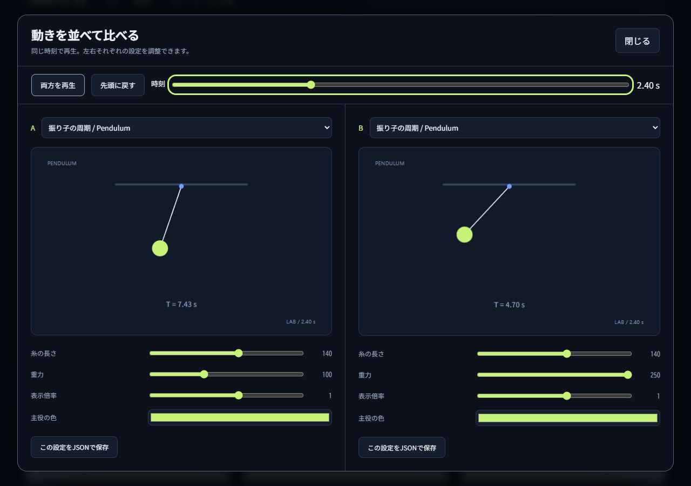

# Motion Atlas

[](https://github.com/RNA4219/motion-atlas/actions/workflows/ci.yml) · [MIT License](LICENSE) · [リリース](https://github.com/RNA4219/motion-atlas/releases/latest)

**フロントエンド向けモーションライブラリ兼エージェントスキル集**です。

200のモーションを見て、調整し、並べて比較して、プロジェクトへ持ち出せるMITライブラリです。
UI 106件・映像58件・数理とゲーム36件。HTML / JavaScript / Canvas 2Dで実装し、実行時の外部ライブラリ・フォント・画像・通信は不要です。

v2では61の作例を追加しました。振り子、布、群れ、軌道、A*経路探索、文字演出、場面転換などを収録し、追加作例にはそれぞれ2つの専用パラメータがあります。同じデモを異なる設定で同時再生し、JSONで設定を持ち出せます。

## すぐ使う

ビルド不要で使う場合は、[最新リリース](https://github.com/RNA4219/motion-atlas/releases/latest)から `motion-atlas-2.0.0.zip` を取得して展開してください。

- **一つだけ使う:** `dist/samples/` のHTMLをダブルクリックで開きます。オフラインで再生・操作できます。
- **まとめて渡す:** `dist/downloads/motion-atlas-all.zip` に200個の単独HTMLとMITライセンスを収録しています。
- **スキルとして渡す:** `dist/downloads/<id>.zip` に `SKILL.md`、説明、デモ、ソース、ライセンスを収録しています。解凍したフォルダを利用するエージェントのスキル配置先へ置きます。
- **一覧で探す:** Node.js 22以降でプロジェクトのルートから `npm run dev` を実行し、<http://127.0.0.1:8792/> を開きます。リリースZIPには構築済みの `dist` を収録しています。

`release/motion-atlas-2.0.0.zip` はソース、構築済みサイト、全サンプル、全スキルZIP、検証資料をまとめた配布物です。`release/SHA256SUMS` で照合できます。

## フロントエンドスキルとして使う

このリポジトリには、200作例を選んで組み込むための [frontend-motion-atlas スキル](SKILL.md) を同梱しています。Codexでは、スキル用フォルダへリポジトリ全体を配置します。既に同名のフォルダがある場合は、現在の内容を確認してから更新してください。

```sh
git clone https://github.com/RNA4219/motion-atlas.git ~/.codex/skills/frontend-motion-atlas
```

`CODEX_HOME` を変更している環境では、その配下の `skills/frontend-motion-atlas` を使います。導入後にCodexを再起動し、たとえば「`$frontend-motion-atlas` を使って、既存のカードUIに控えめな反応を加えて」と依頼します。

任意の項目だけを使う場合は、リリースZIP内の `dist/downloads/<id>.zip` を展開してスキルフォルダへ置きます。個別スキルには `SKILL.md`、デモ、ソース、説明、MITライセンスが含まれます。

ソースからサイトを起動するときは `npm ci` → `npm run build` → `npm run dev` の順で実行します。npmパッケージとしては公開していません。



## 閲覧と操作

検索は名前・日本語の説明・分類を対象に、空白で複数の語を指定できます。シリーズ・カテゴリ・お気に入り・「新規追加61」と組み合わせられます。お気に入りはブラウザ内に保存します。

詳細画面には再生・停止・リセット・速度・強度・時刻、固有の解説、調整値を反映した導入コード、ダウンロードがあります。`#demo=slider` のようなURLで直接開けます。前後ボタンは現在の検索結果の中を移動します。

「動きを調整する」では、全項目の表示倍率・主役の色を変更できます。追加61件には2つずつ、既存のばね・追従・波紋などにも専用の調整項目があります。「設定を保存」は項目ごとにブラウザ内へ1組の設定を保存します。JSONにはデモID、パラメータ、色、時刻、速度、強度を含みます。押下や文字入力などの一時的な操作状態は保存しません。単独HTMLでも設定JSONを読み書きできます。

「2つを比較」では左右の項目とパラメータを独立して選び、同じ時計で再生・停止・シークします。狭い画面では縦に並びます。片側が画面外でも同じ時刻を維持します。左右それぞれの設定を書き出せます。

キャンバスではポインタ、ドラッグ、Enter / Space、矢印を使います。文字入力は画面下の実入力欄で行います。Homeで初期状態に戻ります。周期演出の操作は先頭へ戻し、UIの操作は選択状態を変えます。停止中の入力は結果が見えるように応答を進めて表示します。シークは入力からの経過時間を保ちながら再生時刻を変更します。

通常のプレイヤーは画面外・非表示タブで描画を停止し、一つのフレームループを共有します。比較画面は専用の単一時計で左右を描画し、非表示タブでは停止します。`prefers-reduced-motion` では初期再生を止め、設定変更時も停止します。利用者が明示的に再生した場合は強度を抑えて動きます。

## モジュールとして組み込む

`src` をコピーしてHTTPで配信します。単独HTMLには同じ実装が埋め込まれています。

```html
<canvas style="width:100%;aspect-ratio:1.6;touch-action:none"></canvas>
<script type="module">
  import { createPlayer } from './src/player.js';
  const demo = createPlayer(document.querySelector('canvas'), 'spring');
  demo.setSpeed(0.5);
  demo.setStrength(1);
  demo.setParameter('damping', 0.4);
  demo.setAccent('#ef7087');
  // const json = JSON.stringify(demo.preset());
  // demo.loadPreset(json);
  // demo.pause(); demo.play(); demo.seek(2); demo.reset();
  // demo.activate(); demo.setText('Create');
  // SPAなどで画面を破棄するとき: demo.destroy();
</script>
```

`src/catalog.js` と `expansion.js` で項目と解説、`drawing.js` で配色と描画部品、`math.js` と `lab-math.js` で数理処理を管理します。`controls.js`、`motion.js`、`cinema.js`、`systems.js` と `lab-*.js` が各表現の実装です。`parameters.js` に設定の仕様と検証、`compare.js` に比較画面があります。`render(ctx, entry, time, state, options)` はプレイヤーなしでも利用できます。

UIサンプルはCanvas上で挙動を観察するための作例です。製品のフォームやメニューへ組み込む際は、実装先のHTML部品と支援技術向けの状態表現へ接続してください。元ライブラリのAPI互換や描画の完全一致を目的とした実装ではありません。

## 開発・検証・配布

ソースから構築する場合:

```sh
npm ci
npm run build
npm test
npm run verify
python -X utf8 scripts/verify-artifacts.py
npm run package
npm run dev
```

Python 3.10以降の標準ライブラリでZIPのCRC・構成・MIT・ソース一致を検証できます。スキル用の検査器も実行する場合は `--skill-validator /path/to/quick_validate.py` を付けます（検査器にはPyYAMLが必要です）。Pythonランチャーが `py` の環境では `python` を `py -3` に置き換えてください。

`@napi-rs/canvas` はテスト用の開発依存です。配布サイトと単独HTMLでは使いません。`npm run dev` は127.0.0.1のみに接続を受け付けます。公開する際は `dist` を静的ホストへ配置できます。

検証は35テスト、全200項目の実描画・同時刻の再現性・操作入力・強度端点、専用パラメータ変更時の描画差、比較時計と設定復元、400配布ファイルのSHA-256、全200スキルZIPのCRCと構成を対象にしています。結果と全項目の描画一覧は `reports/` にあります。ブラウザではデスクトップと390px幅で代表操作を確認しています。実機スマホと他のブラウザでの動作は未検証です。検証用ブラウザはfile://へのアクセスを許可しないため、単独HTMLはローカルHTTPでの動作と、外部参照・通信のない構成を検証しています。

## 出典とライセンス

最初の139項目の題材は「動きの引き出し」https://kumagi.com/motions/ を参考にしています。追加61項目は一般的なUI表現、文字演出、幾何学、数値シミュレーションから独自に選定しました。
このリポジトリのコード、解説、配色、ページ構成、サンプルは新規に作成しました。
参照サイトからダウンロードしたコード・文章・フォント・WASM・スキルZIPは同梱しません。
参照対象を閲覧したうえでの新規実装であり、クリーンルーム開発という主張はしていません。

本リポジトリの新規成果物は [MIT License](LICENSE) です。第三者の商標は権利者に帰属します。
改変・商用利用・再配布時も著作権表示とライセンス本文を保持してください。参照元の成果物に対してMITを付与するものではありません。

完成条件は [REQUIREMENTS.md](REQUIREMENTS.md)、実施記録は [WORKLOG.md](WORKLOG.md) にあります。

変更の提案は [CONTRIBUTING.md](CONTRIBUTING.md)、公開版の履歴は [CHANGELOG.md](CHANGELOG.md) を参照してください。
